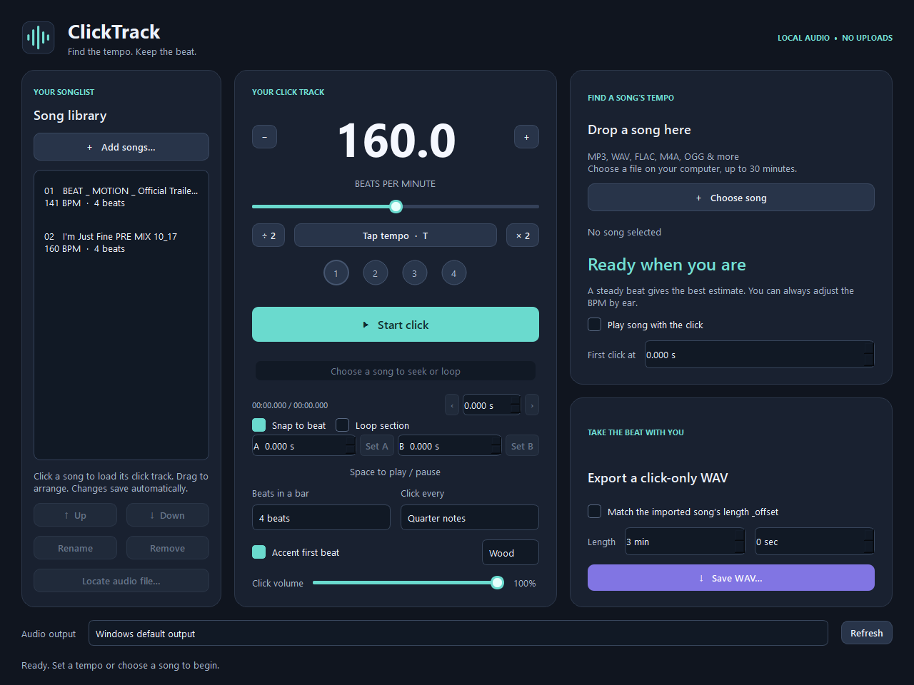

# ClickTrack

A desktop metronome, song tempo finder, saved setlist, and practice looper for Windows and Mac. Everything runs locally. No account, upload, subscription, or Python installation is needed to run a release.

## Download and open

Get a ZIP from [Releases](https://github.com/Dr-Ake/Click-Track/releases/latest).

| Computer | Download | Open |
| --- | --- | --- |
| Windows 10/11, 64 bit | `windows-x64.zip` | Extract the whole ZIP to a writable folder, then open `app/ClickTrack.exe`. Keep `_internal` beside the EXE. |
| Mac with Apple Silicon (M1 or newer), macOS 15+ | `macos-arm64.zip` | Extract, then drag `ClickTrack.app` to Applications. |
| Intel Mac, macOS 15+ | `macos-x86_64.zip` | Extract, then drag `ClickTrack.app` to Applications. |

The releases are unsigned; macOS builds have an ad hoc signature and are not notarized. After attempting to open a Mac download, approve it in **System Settings → Privacy & Security → Open Anyway** if macOS blocks it. See [Apple's instructions](https://support.apple.com/en-us/102445). Windows may also show an unknown publisher notice.

## Practice

- Set a tempo from 20–300 BPM, tap a tempo, and choose accents, subdivisions, click sound, and volume.
- Add songs to estimate their BPM offline. Correct the tempo or first-click position, then save those settings with each song.
- Arrange the song library into a setlist. Selecting a song loads its saved click settings.
- Scrub to a precise position with optional beat snapping. Drag A/B brackets to loop a practice section with the song and click together.
- Export a click-only WAV for a selected duration or the full song.

The detector estimates one steady tempo and a first pulse. It does not identify musical downbeats or follow tempo changes; some songs need manual adjustment. Common inputs include WAV, MP3, FLAC, M4A, AAC, OGG, OPUS, WMA, and AIFF, up to 30 minutes. See [Quick start.txt](Quick%20start.txt) for controls.

## Your library

Song files stay in their original folders. ClickTrack stores references and your saved settings; removing a library entry does not delete audio.

On Windows, library, settings, and logs live in `data` beside the `app` folder. Keep the entire extracted folder when updating or moving your installation. On Mac, they live in `~/Library/Application Support/ClickTrack`, outside the application. Back up that data and your original song files separately.

## Build from source

Use Python 3.12 and install `source/requirements-dev.txt` on Windows or `source/requirements-mac-dev.txt` on Mac into a virtual environment. Run `python source/app.py` or `python -m pytest tests -q`. Source development requires Python; release downloads already include it.

The [release workflow](.github/workflows/release.yml) builds Windows x64 and native Mac arm64/x86_64 packages, runs tests and a packaged-app smoke check, and publishes only after all three platforms succeed. Dispatch it with a three-part version and Publish enabled, or push a `vX.Y.Z` tag. Repeated builds of a published version are rejected.

All platforms build a local-file-only FFmpeg decoder from the exact official source pinned in `source/decoder-source.json`. Run `python source/Fetch-Decoder-Source.py`, then `bash source/Build-Decoder.sh work/decoder-source/ffmpeg-9.0.1.tar.xz` on Mac or in MSYS2 MINGW64 on Windows. Set `CLICKTRACK_FFMPEG` to the resulting native executable. Build with `source/Build.ps1` and `source/Package-Release.ps1 -Version X.Y.Z` on Windows, or `bash source/Build-Mac.sh X.Y.Z arm64` (or `x86_64`) on a matching Mac. Build outputs go to `work`, release ZIPs to `outputs`.

Windows uses Qt/PySide 6.12.0. Mac uses 6.11.2 because its actual native deployment targets support macOS 15; the 6.12.0 Shiboken library requires macOS 26 despite its wheel label. Every bundled Mac binary is checked before packaging.

Releases include third-party notices. The exact FFmpeg source archive and build recipe accompany the release; the decoder is a separate LGPL 2.1-or-later component. Other components retain the license terms in `licenses`. ClickTrack releases are free to download and run.
